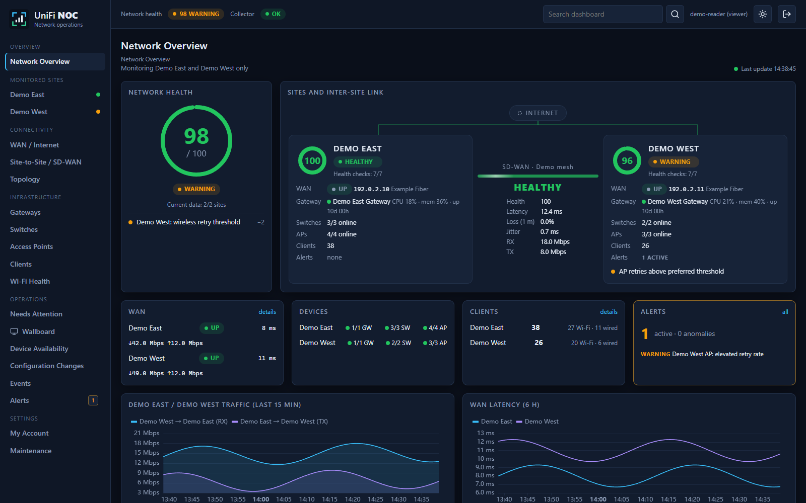

# Unifi-NOC

A self-hosted network operations dashboard for UniFi: site health, WAN, SD-WAN, device telemetry, topology, client activity and actionable alerts in one place.

**Source-available for noncommercial use under [PolyForm Noncommercial 1.0.0](LICENSE). Not an OSI open-source license. Commercial use requires separate permission.**

[Project Website](https://marinfrankovic.github.io/Unifi-NOC/) | [Deployment Guide](https://github.com/marinfrankovic/Unifi-NOC/blob/main/docs/deployment.md) | [User Guide](https://github.com/marinfrankovic/Unifi-NOC/blob/main/docs/user-guide.md) | [Releases](https://github.com/marinfrankovic/Unifi-NOC/releases) | [Report an Issue](https://github.com/marinfrankovic/Unifi-NOC/issues)



All published screenshots use synthetic data. No real controller settings, customer records, device addresses or production credentials are included.

## What You Can Monitor

| Area | Available views and measurements |
| --- | --- |
| Sites | Health scores, current coverage, freshness, site inventory and incidents |
| WAN | Link state, ISP/address information, traffic, latency and reported outages |
| Site-to-site | Discovered VPN/SD-WAN connections, controller connection state, traffic, optional RTT/jitter/loss |
| Gateways | CPU, memory, uptime, available temperatures, interfaces and traffic |
| Switches | Port state/speed, traffic, errors/drops, PoE and connected clients where reported |
| Access points | Radio/channel data, signal, retries, airtime and associated clients where reported |
| Clients | Wired/wireless clients, device/site context, available traffic and event history |
| Operations | Unacknowledged alerts, attention queue, maintenance, availability and configuration-change history |
| Topology | Discovered sites, devices, clients and inter-site links; search, zoom and navigation |
| Wallboard | Fullscreen site/WAN summary, link matrix, telemetry and incidents |
| History | Linked charts, rollups, event overlays and explicit missing-data gaps |

Measurements depend on controller version, device support, permissions and routing. **Unavailable is not zero. Connected is not proof that probes or traffic counters are available.** See the [monitoring reference](https://github.com/marinfrankovic/Unifi-NOC/blob/main/docs/monitoring.md).

## Quick Start

Use a Linux x86-64 Docker host with Docker Compose 2.30 or newer, at least 2 CPU cores, 4 GB RAM and persistent disk capacity appropriate to your telemetry volume. The first release targets Linux/amd64.

```bash
git clone https://github.com/marinfrankovic/Unifi-NOC.git
cd Unifi-NOC
cp .env.example .env
docker compose pull
docker compose up -d
```

Open **https://localhost:8096/unifi/** on the Docker host. The initial self-signed web certificate produces a browser warning; install a trusted certificate before sharing access. HTTP port 8095 only redirects to HTTPS.

1. Create the initial owner account in the setup screen while access remains restricted.
2. Enter the reachable UniFi OS HTTPS URL and a Network integration API key with the least available permissions.
3. Verify controller TLS, supplying the controller CA and certificate hostname when needed. Insecure controller TLS is not supported.
4. Select the sites to monitor. Review the initial discovery selection before collecting more data than intended.
5. Optionally enable gateway SSH measurements and ICMP probes only on networks you are authorized to monitor.
6. Create site-scoped reader or administrator accounts and configure alerts/notifications.

The default ports bind to loopback. For another machine, use an SSH tunnel or follow the [LAN/reverse-proxy deployment instructions](https://github.com/marinfrankovic/Unifi-NOC/blob/main/docs/deployment.md). Do not expose a fresh setup screen to the internet.

## Images And Data

| Image | Purpose |
| --- | --- |
| [mfrankovic/unifi-noc-backend](https://hub.docker.com/r/mfrankovic/unifi-noc-backend) | API and collector, run as separate services |
| [mfrankovic/unifi-noc-web](https://hub.docker.com/r/mfrankovic/unifi-noc-web) | Dashboard, TLS termination and API reverse proxy |

The Compose stack also runs PostgreSQL/TimescaleDB and a one-time database-secret initializer. There is no separate Grafana dependency. Named volumes preserve the database, controller-profile encryption key, database password and web certificate. **Never use `docker compose down -v` for an upgrade.**

## Manage And Upgrade

```bash
docker compose ps
docker compose logs --tail=100 api collector web
bash backup.sh ./backups
```

Back up before changing `NOC_VERSION` in the private `.env`. Pull the chosen version and run `docker compose up -d`. Keep the same directory, project name and volume mappings. Follow the [administration and recovery guide](https://github.com/marinfrankovic/Unifi-NOC/blob/main/docs/administration.md), including rollback limitations after database migrations.

## Publish Local Changes

The public checkout is the source of truth for publishable code and public defaults. On Windows:

```powershell
./tools/publish.ps1 -Message "Describe the change"
```

The helper checks privacy, builds the frontend, commits reviewed changes and pushes `main`. A VS Code task provides the same action. Every `main` push updates GitHub Pages and publishes unique development image tags plus `edge`; version tags publish stable images. Production `.env`, accounts, encrypted profiles, notification tokens, backups and runtime data are never synchronized to GitHub. No file-save watcher or unattended private-host updater is installed. See [publishing and releases](https://github.com/marinfrankovic/Unifi-NOC/blob/main/docs/publishing.md).

## Documentation

- [Deploy, first setup, TLS and routing](https://github.com/marinfrankovic/Unifi-NOC/blob/main/docs/deployment.md)
- [Navigate the dashboard and manage alerts](https://github.com/marinfrankovic/Unifi-NOC/blob/main/docs/user-guide.md)
- [Monitoring coverage, intervals and limitations](https://github.com/marinfrankovic/Unifi-NOC/blob/main/docs/monitoring.md)
- [Users, settings, backups, upgrades and recovery](https://github.com/marinfrankovic/Unifi-NOC/blob/main/docs/administration.md)
- [Troubleshooting](https://github.com/marinfrankovic/Unifi-NOC/blob/main/docs/troubleshooting.md)
- [Security reporting](https://github.com/marinfrankovic/Unifi-NOC/blob/main/SECURITY.md)
- [Contributing](https://github.com/marinfrankovic/Unifi-NOC/blob/main/CONTRIBUTING.md)

## Disclaimers

Unifi-NOC is an independent community project, not affiliated with, endorsed by or supported by Ubiquiti Inc. UniFi and Ubiquiti are trademarks of their owner and identify compatibility only. No Ubiquiti software or API entitlement is supplied.

This software is provided **as-is, without warranty or service-level commitments**. It is not a substitute for professional security monitoring or vendor-supported management. Controller APIs and device capabilities may change. Health scores and timing correlations are diagnostic aids, not guarantees or proof of root cause.

The application does not intentionally write UniFi configuration. Optional probes send traffic and optional SSH collection executes measurement commands. Only monitor authorized networks. Telemetry can include personal information; you are responsible for lawful collection, access control, retention and secure backups. Dependency and base-image licenses remain independent. Read [LICENSE](LICENSE) and [NOTICE](NOTICE).